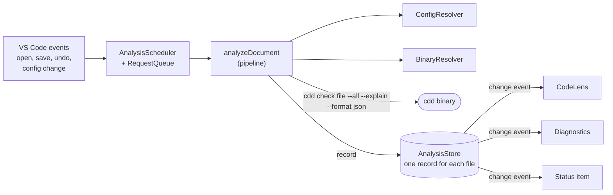

# Contributing to CDD Lint

Contributions are welcome. You can help in these ways:

- Report a bug.
- Suggest an improvement.
- Improve the documentation.
- Send a pull request.

This repository contains the VS Code extension only. The `cdd` binary that calculates the scores is in the [cdd-lint](https://github.com/jonasalessi/cdd-lint) repository. Report a wrong score or a problem with `cdd.config.yaml` there.

## Architecture

### The big picture

The extension is a thin layer between VS Code and the `cdd` binary. It does not calculate scores, and it has no language server and no background service. For each file, it runs the binary one time, keeps the result in memory, and shows that result in three places.



Data moves in one direction. The left side writes to the store, and the right side only reads from it. A CodeLens request or a diagnostic update never starts a process.

### The path of one analysis

1. **Trigger.** `AnalysisScheduler` listens to VS Code events and asks `RequestQueue` for an analysis of a document.
2. **Scheduling.** `RequestQueue` ignores a document that is not supported or has unsaved changes. It waits 50 ms, so a save that fires two events gives one run. It keeps a maximum of one active pipeline for each document and aborts the older one.
3. **Pipeline.** `analyzeDocument` runs three steps. The first step that fails sets the record and ends the pipeline.
   1. `ConfigResolver` finds the nearest `cdd.config.yaml`.
   2. `BinaryResolver` finds a valid `cdd` binary.
   3. `runCddCheck` runs the binary, and `classifyRun` turns the exit code, stdout and stderr into one outcome.
4. **Record.** The queue writes the result to `AnalysisStore` only if the document is still open and its version did not change during the run.
5. **Presentation.** The store emits a change event. The CodeLens provider, the diagnostics publisher and the status item read the record and update.

When you type in a file, no analysis starts. `shiftUnits` moves the stored line of each code unit, so the scores follow the code until the next save.

### Pure files and adapter files

Each source file is one of two kinds:

- **Adapter files** import `vscode`. They register commands, listen to events and convert plain data to VS Code objects. They hold no decision logic. `eslint.config.mjs` lists these files, and ESLint rejects a `vscode` import in any other file.
- **Pure files** hold all decisions. They receive what they need as plain values or as functions: the process function (`execFile`), the network function (`https.get`), the setting values, the timers and an `AbortSignal`. Unit tests replace these functions, so the tests need no VS Code and no real binary.

For example, `buildLenses.ts` returns `{ line, scoreTitle, tooltipLines, toggleTitle }`, and `CddCodeLensProvider.ts` converts that to `CodeLens` objects.

`src/extension.ts` is the composition root. It creates the modules and connects them, and it is the best file to read first.

### Folders

| Folder             | Responsibility                                                                                                          | Start with                                                |
| ------------------ | ----------------------------------------------------------------------------------------------------------------------- | --------------------------------------------------------- |
| `src/analysis/`    | Triggers, scheduling, the pipeline, the run of the binary, the classification of a run and the store.                   | `analyzeDocument.ts`, `requestQueue.ts`, `classifyRun.ts` |
| `src/config/`      | Finds `cdd.config.yaml` for a document and watches these files for changes.                                             | `ConfigResolver.ts`                                       |
| `src/binary/`      | Finds and validates the `cdd` binary, and holds the constants of the pinned release.                                    | `BinaryResolver.ts`                                       |
| `src/install/`     | Downloads, verifies, extracts and activates the managed binary, after the user approves.                                | `installManagedBinary.ts`, `installFlow.ts`               |
| `src/code-lens/`   | Builds the score lens and the toggle lens of each code unit from a record.                                              | `buildLenses.ts`                                          |
| `src/icp-details/` | Builds the line labels and the construct hover from the occurrences of a record, and holds which files show the labels. | `buildLineDetails.ts`, `buildHoverLines.ts`               |
| `src/diagnostics/` | Builds the diagnostics from a record.                                                                                   | `buildDiagnostics.ts`                                     |
| `src/status/`      | The language status item and the notifications, each shown a limited number of times.                                   | `statusText.ts`, `analysisNotifications.ts`               |
| `src/logging/`     | The `CDD` Output Channel.                                                                                               | `logger.ts`                                               |
| `contract/`        | Contract tests. They run the real binary on small fixture projects and check the facts that `classifyRun` depends on.   | `checkRows.contract.test.ts`                              |
| `e2e/`             | Extension-host tests. They run in a real VS Code with a fake binary, so each test controls the response of the binary.  | `analysis.test.ts`, `fake-cdd/cdd`                        |

### Three levels of tests

| Level          | Location           | What it proves                                                 |
| -------------- | ------------------ | -------------------------------------------------------------- |
| Unit           | `src/**/*.test.ts` | The decisions of the pure files are correct.                   |
| Contract       | `contract/`        | The real `cdd` binary still behaves as the extension expects.  |
| Extension host | `e2e/`             | The adapter files connect the pure files to VS Code correctly. |

If a new cdd-lint release changes its output, the contract tests fail first. Start there when you update the pinned release.

## Prerequisites

- Node.js 22 or later, and npm.
- A `cdd` binary on `PATH`, version `v0.1.0` or later. The contract tests run this binary.
- The `code` command on `PATH`. To add it, run `Shell Command: Install 'code' command in PATH` from the VS Code command palette.

Install the dependencies:

```sh
npm ci
```

## Run the extension from the source code

This method starts a second VS Code window that loads the extension from the repository. It does not install the extension.

```sh
npm run build
code --extensionDevelopmentPath="$PWD" /path/to/a/project
```

- The new window has `[Extension Development Host]` in its title.
- The project must have a `cdd.config.yaml` and a supported file. If it has no `cdd.config.yaml`, run `cdd init` in the project.
- After you change the code, run `npm run build` again. Then run `Developer: Reload Window` in the Extension Development Host window.

## Install the packaged extension

This method tests the same VSIX file that a release publishes.

```sh
npm run build
npm run package
code --install-extension cdd-lint-vscode-0.1.0.vsix --force
```

Then run `Developer: Reload Window`. To remove the extension:

```sh
code --uninstall-extension jonasalessi.cdd-lint-vscode
```

## Check that the extension works

1. Open a supported file. An ICP score appears above the first line of each code unit, with no save.
2. Hover over a score. The tooltip shows the metrics of the score.
3. Open the language status with the `{}` icon in the status bar. The CDD item shows the highest ICP score of the file.
4. Make a code unit exceed its limit and save the file. The Problems panel shows a `CDD` diagnostic.
5. Run `CDD: Show Output`. The Output Channel shows each run of the binary.

If no score appears, the CDD item of the language status shows the reason. Also make sure that the workspace is trusted and that `editor.codeLens` is `true`.

## Run the tests

| Command                 | Action                                                                             |
| ----------------------- | ---------------------------------------------------------------------------------- |
| `npm run lint`          | Runs ESLint and the Prettier check.                                                |
| `npm run build`         | Checks the types and creates the bundle `dist/extension.js`.                       |
| `npm run test`          | Runs the unit tests.                                                               |
| `npm run test:contract` | Runs the contract tests with the real binary. It fails if `CDD_BIN` is not set.    |
| `npm run test:e2e`      | Runs the extension-host tests in a downloaded copy of VS Code, with a fake binary. |
| `npm run package`       | Creates the VSIX file and checks its content.                                      |
| `npm run verify`        | Runs all the commands above, in this order. Run it before you open a pull request. |

The contract tests need the path of the real binary:

```sh
CDD_BIN="$(command -v cdd)" npm run verify
```

One contract test downloads and installs the pinned cdd-lint release in a temporary directory. It runs only when `CDD_NETWORK_TESTS` is `1`:

```sh
CDD_NETWORK_TESTS=1 CDD_BIN="$(command -v cdd)" npm run test:contract
```

The extension-host tests open VS Code windows. Do not use the keyboard or the mouse in these windows while the tests run.

## Code rules

- Write the tests of a module together with the module. Unit tests are next to the code, in `src/**/*.test.ts`.
- Keep a function small, with one responsibility and a maximum of 4 parameters.
- Keep one responsibility in each file. The folders in `src/` are feature-based.
- Import `vscode` only in the adapter files that `eslint.config.mjs` lists. Put all decision logic in the other files, so that unit tests cover it.
- The extension never calculates ICP. The `cdd` binary is the only source of the scores.

## Pull requests

1. Create a branch from `main`.
2. Make your change, with tests.
3. Run `CDD_BIN="$(command -v cdd)" npm run verify`. It must exit with code `0`.
4. Open a pull request that explains what the change does and why.
